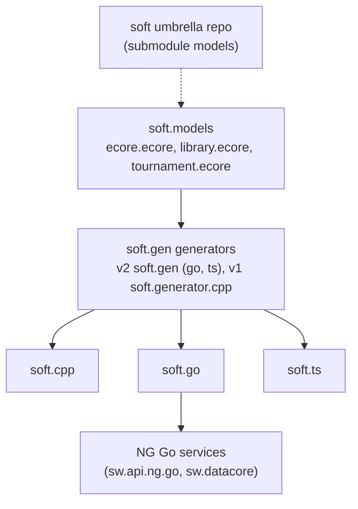
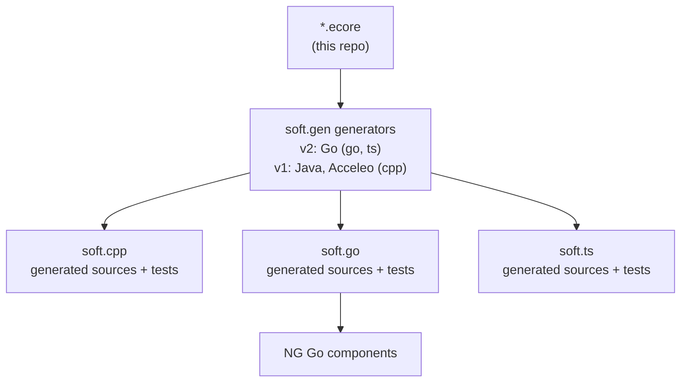
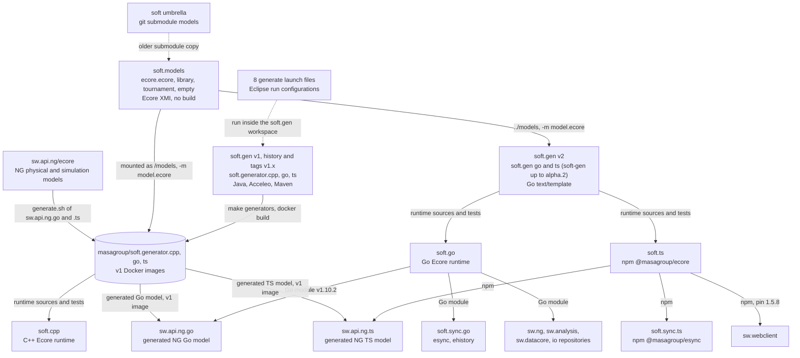
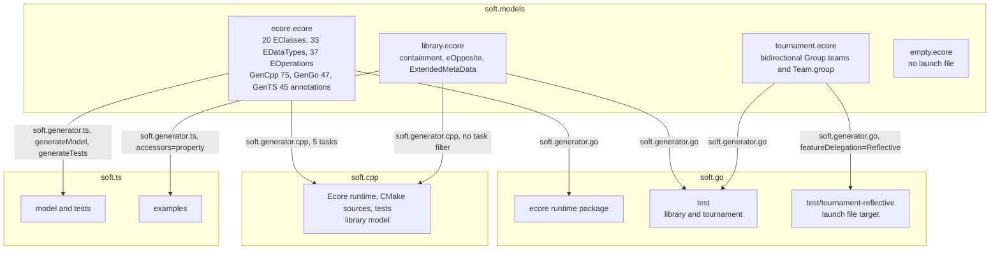
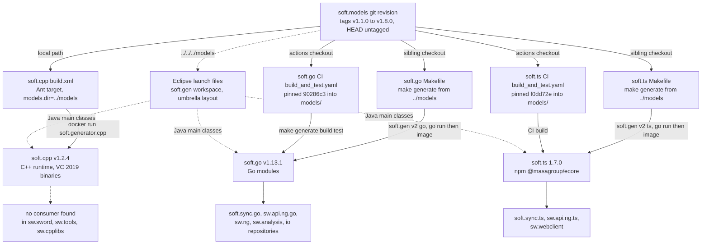

# soft.models: architecture

> Technical choices, diagrams and internal structure of `soft.models`. Back to the [README](README.md) · [Contributing](CONTRIBUTING.md) · [repository on GitHub](https://github.com/masagroup/soft.models)

| | |
|---|---|
| **Family** | Ecore / esync |
| **Kind** | ecore model |
| **Languages** | XML (Ecore/XMI), Eclipse launch XML. No Go, C++, TypeScript or Python source. |
| **Remote / branch** | github.com/masagroup/soft.models, default branch `master` |
| **Generation** | shared |
| **Build systems** | None (no `build.xml`, Dockerfile, CMake, `go.mod`, Makefile or `package.json`) |

## Overview

The repository in its ecosystem (the text is in the [README](README.md#overview)):



## Position in the ecosystem

| Component | Relation |
|---|---|
| ecore model | Implements the Ecore meta-model itself in SOFT form. NG-specific models are not here: they live in `sw/sw.api.ng/ecore/` ([sw.api.ng](https://github.com/masagroup/sw.api.ng), generated Go code in [sw.api.ng.go](https://github.com/masagroup/sw.api.ng.go)). |
| esync | Not implemented here. Indirect: [soft.sync.go](https://github.com/masagroup/soft.sync.go) (esync, v1 and v2 protocol in [soft.sync.pb](https://github.com/masagroup/soft.sync.pb)) builds on `soft.go` (`soft.sync.go/go.mod` requires `soft.go v1.11.0`), itself generated from `ecore.ecore`. |
| datacore | Indirect consumer of `soft.go` ([sw.datacore](https://github.com/masagroup/sw.datacore); `sw/sw.datacore/go.mod` requires `soft.go v1.10.2`). `sw/sw.api.ng.go/go.mod` requires the same version. |
| gateway, history, dos, storage, authentication, node, orchestrator, commander, hub, recorder, timeline, mapserver, webclient, dispatcher, HLA | Unrelated (no mention in the repository files). |

`sw/sw.api.ng.go/generate.sh` runs the `masagroup/soft.generator.go` image on `modules/sw.api.ng/ecore/physical/*.ecore`. The repository is a foundation-level design-time dependency (through `soft.go`, `soft.ts`, `soft.cpp`), not an NG component. See the ecosystem wiki page [Next generation ecosystem](https://github.com/masagroup/wiki/wiki/ecosystem-nextgen).

## Repository layout

The repository root is flat: no subdirectories, no `.github`, no README, no LICENSE.

```
soft.models/
  ecore.ecore                            # SOFT Ecore meta-model with generator annotations (1048 lines)
  library.ecore                          # EMF "library" example model (198 lines)
  tournament.ecore                       # tournament example model with eOpposite (42 lines)
  empty.ecore                            # empty package `empty`, nsURI `empty` (3 lines)
  generate.ecore.{cpp,go,ts}.launch      # Eclipse run configurations: regenerate the Ecore runtime
  generate.library.{cpp,go,ts}.launch    # Eclipse run configurations: library test/example model
  generate.tournament.go.launch          # Eclipse run configuration: tournament model (Go)
  generate.tournament-reflective.go.launch  # tournament with featureDelegation=Reflective (Go)
  .project                               # bare Eclipse project descriptor `soft.models`
```

## Architecture

### Models

| File | Package / nsURI | Content |
|---|---|---|
| `ecore.ecore` | `ecore`, `http://www.eclipse.org/emf/2002/Ecore` | 20 EClasses, 33 EDataTypes, 37 EOperations (counts by grep) |
| `library.ecore` | `library` (prefix `lib`) | Book, BookIndex (renamed from Index; map entry), Library, Writer, Item, Lendable, CirculatingItem, Periodical, AudioVisualItem, BookOnTape, VideoCassette, Borrower, Person, Employee, Addressable, DocumentRoot; enum BookCategory |
| `tournament.ecore` | `tournament`, `http://mattsch.com/emf/examples/tournament` | Tournament, NamedElement (abstract), Group, Team, Match; enum MatchKind; bidirectional Group.teams / Team.group |
| `empty.ecore` | `empty`, nsURI `empty` | Empty package; no launch configuration references it |

**`ecore.ecore`**

* EClasses: EAttribute, EAnnotation, EClass, EClassifier, EDataType, EEnum, EEnumLiteral, EFactory, EModelElement, ENamedElement, EObject, EOperation, EPackage, EParameter, EReference, EStructuralFeature, ETypedElement, EStringToStringMapEntry, EGenericType, ETypeParameter.
* EDataTypes: the usual EMF primitives and wrappers (EBoolean, EInt, ELong, EString, EDate, EBigInteger, EBigDecimal, ...) plus EEList, EMap, EFeatureMap, EResource, EResourceSet, ETreeIterator, EDiagnosticChain, EJavaClass, EJavaObject, EInvocationTargetException, EEnumerator, etc.
* Package-level annotations (lines 4-16): GenCpp `factory=extension`, `lazy=list:function`; GenGo `lazy=list:function`, `rootExtendsClass=github.com/masagroup/soft.go/ecore/ecore.CompactEObjectContainer`, `exported=true`; GenTS `lazy=list:function`.
* The model drives generation of the Ecore runtime itself in the three languages: generated base classes plus hand-written "extension" implementations (`extension=true` appears 36 times across the three generators).
* TypeScript-specific: `async=true` on two eGet operations (lines ~556 and ~572) and `operationName=eGetResolve`.
* C++-specific: `instanceTypeName` (for example `std::string`, `std::shared_ptr<ecore::EResource>`) and `include` headers per datatype.

**`library.ecore`** uses containment, eOpposite, `ExtendedMetaData` and unsettable features. GenGo/GenTS `supressAnnotations` (spelling as in the file) hides the other generators' annotations. It generates tests and examples (`go/test`, `ts/examples`, C++).

**`tournament.ecore`** generates Go tests, including the "reflective" variant (`featureDelegation=Reflective`).

### Annotation conventions (generator extension points)

Annotation sources used in `ecore.ecore` (occurrence counts):

| Source URI | Occurrences |
|---|---|
| `http://net.masagroup/soft/2018/GenCpp` | 75 |
| `http://net.masagroup/soft/2019/GenGo` | 47 |
| `http://net.masagroup/soft/2020/GenTS` | 45 |

Standard `http://www.eclipse.org/emf/2002/Ecore` (constraints) and `http:///org/eclipse/emf/ecore/util/ExtendedMetaData` annotations are also used.

Detail keys in `ecore.ecore` (counts): `lazy` 42, `extension` 36, `default` 30, `instanceTypeName` 27, `const` 27, `baseType` 19, `visibility` 15, `constraints` 12, `operationName` 8, `name` 8, `include` 7, `exported` 5, `unsetVisibility` / `setVisibility` / `issetVisibility` 3 each, `async` 2, `rootExtendsClass` 1, `factory` 1. In `library.ecore`: `supressAnnotations`.

### Data flow



`*.ecore` -> generators of `soft.gen` (v2, Go: `soft.gen go` and `soft.gen ts` for soft.go and soft.ts; v1, Java and Acceleo: the image `masagroup/soft.generator.cpp` for soft.cpp) -> sources written into `soft.cpp` / `soft.go` / `soft.ts` and their tests or examples. Those runtime libraries provide Ecore objects to downstream C++, Go and TypeScript components. See the ecosystem wiki page [esync and ecore](https://github.com/masagroup/wiki/wiki/esync-ecore) for the full model/esync picture.

## How it works

soft.models builds no binary and runs nothing. It is a flat set of Ecore XMI files: `ecore.ecore` (the SOFT port of the Eclipse EMF Ecore meta-model, annotated with C++, Go and TypeScript generator hints), the sample models `library.ecore`, `tournament.ecore` and `empty.ecore`, and eight Eclipse launch configurations. The only thing that runs on these files is the SOFT generator chain of soft.gen: `soft-gen go` and `soft-gen ts` of soft.gen v2 (Go `text/template` generators, run by the Makefiles of soft.go and soft.ts) and the v1 generators `soft.generator.cpp`, `.go` and `.ts` (Java and Acceleo, as Docker images or Eclipse run configurations, still used by soft.cpp and the sw.api.ng.* repositories), started by the builds of the runtime repositories. It reads a `.ecore` file and writes generated sources and tests into soft.cpp, soft.go and soft.ts, which together make up the Ecore runtime. The repository is a shared foundation and a design-time dependency of the Ecore / esync stack. No old gen or next gen component reads it at runtime, and the NG-specific models live in sw.api.ng. The next gen link is indirect: soft.go is generated from `ecore.ecore`, and soft.sync.go (esync), sw.api.ng.go, sw.ng and sw.datacore are built on soft.go.

### Components and data flow



- Nothing in soft.models starts anything. Consumers read a checkout of it as `../models` (mounted in the generator container, on `/soft/models` in the soft.gen image that soft.go and soft.ts run) and run a generator with `-m` (model), `-o` (output directory), `-P` (properties file), `-p key=value` (single property) and `-t` (template or task, repeatable). soft.cpp does it from an Ant target of its root `build.xml` (`models.dir` defaults to `../models`) that runs the v1 image `masagroup/soft.generator.cpp`; soft.go and soft.ts from `make generate` with a sibling `../models`, which runs soft.gen v2 at `SOFT_GEN_VERSION` (`go run .../cmd/soft-gen@v2.0.0-alpha.2`, or a golang container when Go is missing, until 2026-10-22; the image `masagroup/soft.gen` since); and the CI of soft.go and soft.ts from a checkout of a pinned commit. soft.go and soft.ts no longer use the v1 images `masagroup/soft.generator.go` and `.ts`. The command is `cmd/soft-gen` up to `v2.0.0-alpha.2` and `cmd/soft.gen` from `v2.0.0-alpha.3`.
- The eight `generate.*.launch` files are the developer path. They run the main classes `soft.generator.cpp|go|ts.Generate` of the Maven-built soft.gen projects in Eclipse (Maven classpath provider) and write straight into `../../../cpp`, `go` and `ts`, which assumes the umbrella `soft` layout (`gen/`, `models/`, `cpp/`, `go/`, `ts/`) and a soft.gen v1 checkout: the Maven projects are no longer in soft.gen master, which holds the Go generators. Whether these paths still work in the flat `soft.*` workspace layout is UNVERIFIED: the scan never ran them.
- `ecore.ecore` produces the Ecore runtime itself: soft.go (`soft.go/ecore`), soft.ts and soft.cpp regenerate their `ecore` package from it. A change in `ecore.ecore` or in the soft.gen templates therefore spreads from soft.gen to the runtimes, then to `sw.api.ng.*`, then to their consumers.
- The same v1 generator images also turn the NG models of `sw.api.ng/ecore` (45 physical packages plus `simulation/model` and `system`) into sw.api.ng.go and sw.api.ng.ts. Those models are not in soft.models. sw.api.ng.go maps the Ecore package to `soft.go/ecore` plus `soft.sync.go/esync` and uses `esync.CompactEObjectContainer` as `rootExtendsClass`, so the generated NG classes are esync v1 aware. `ecore.ecore` itself uses the GenGo `rootExtendsClass` `github.com/masagroup/soft.go/ecore/ecore.CompactEObjectContainer`.
- Downstream versions: soft.sync.go requires soft.go v1.11.0, while sw.api.ng.go and sw.datacore require v1.10.2 and sw.ng pins v1.10.2. sw.datacore swaps soft.go, soft.sync.go and sw.api.ng.go for forks through `replace` directives. soft.ts feeds soft.sync.ts, sw.api.ng.ts and sw.webclient (pinned at 1.5.8). No consumer of soft.cpp was found in sw.sword, sw.tools or sw.cpplibs.
- A text grep found no next gen repository that names soft.models, but the grep may be incomplete on large trees (UNVERIFIED). The umbrella `soft` repository is historical and the transverse analysis finds nothing consuming it (only soft.sync.studio links the `ts` submodule checkout of the umbrella, by `file:`, per the soft.ts and soft.sync.studio pages), and its `models` submodule copy is older (it lacks `generate.tournament-reflective.go.launch`).

### Inside the models and the generation matrix



- `ecore.ecore` (1048 lines, package `ecore`, nsURI `http://www.eclipse.org/emf/2002/Ecore`) reproduces EMF Ecore: EObject, EClass, EPackage, EReference, EAttribute, EOperation, EGenericType and the other EClasses, EMF primitives and wrappers, and EEList, EMap, EResource, EResourceSet and similar types. Its `instanceClassName` values are still Java EMF classes.
- Generator hints are EAnnotations, one source per language: `http://net.masagroup/soft/2018/GenCpp`, `.../2019/GenGo` and `.../2020/GenTS`. The package-level ones (lines 4-16) set GenCpp `factory=extension` and `lazy=list:function`, GenGo `lazy`, `rootExtendsClass` and `exported=true`, and GenTS `lazy`. The most frequent detail keys are `lazy` (42), `extension` (36), `default` (30), `instanceTypeName` (27) and `const` (27). `extension=true` marks generated base classes that a hand-written "extension" implementation completes in the runtime repository.
- Hints specific to one language: on the C++ side, `instanceTypeName` (`std::string`, `std::shared_ptr<ecore::EResource>`) and an `include` header per datatype; on the TypeScript side, `async=true` on two eGet operations and `operationName=eGetResolve`.
- `library.ecore` (198 lines) tests containment, eOpposite, `ExtendedMetaData` and unsettable features. Its GenGo/GenTS `supressAnnotations` key (spelled this way in the file) hides the annotations of the other generators. `tournament.ecore` (42 lines) tests a bidirectional reference. Its reflective variant uses `featureDelegation=Reflective`, a mode in which every feature access goes through a store. soft.sync.go v2 requires that mode, so this soft.go test covers the generation mode that esync v2 depends on. The matrix above is the one of the Eclipse launch files (v1 generators). In soft.go the Makefile now runs `soft-gen go` on `tournament.ecore` three times (shared interfaces in `test/tournament`, a typed implementation in `test/tournament/typed`, a reflective one in `test/tournament/reflective`) and on `empty.ecore` and `library.ecore` into `test/`, and soft.ts regenerates `examples/{empty,library,tournament,inheritance,coexistence}` with `soft-gen ts`.
- `empty.ecore` (package `empty`, nsURI `empty`) is used by no launch file. Its purpose is UNVERIFIED.
- The launch files are not consistent with each other. `generate.ecore.go` and `generate.library.go` pass no `-P generator.properties`, but `tournament-reflective` does. `generate.library.cpp` has no `-t` filter, but `generate.ecore.cpp` lists five tasks. The umbrella `soft/cpp/build.xml` still uses the older `-t !generateLibraryCMakeProject -t !generateTestsCMakeProject` form.

### From sources to artifacts



- soft.models has no build file and no `.github/`, so it builds no workflow, artifact or release. Versions are git commits. There are nine tags from `v1.1.0` to `v1.8.0`; `v1.8.0` is `91fcdc5` (2023-09-22), 15 commits behind HEAD. HEAD `f0dd72e` (merge of PR #25 `ecore.factory`, 2024-09-19) has no tag.
- Each consumer picks the revision it uses. The soft.go CI pins `90286c3` (merge of PR #22 `rename.library.index`, 9 commits behind HEAD, so without PRs #23 to #25) and runs `make generate build test`. Whether that lag is intentional is UNVERIFIED. The soft.ts CI pins `f0dd72e` (HEAD) and runs `make ci`, which does not call the generator, so that checkout appears unused (soft.ts page, UNVERIFIED). A change here reaches a consumer's CI only after that consumer bumps the SHA in its workflow. soft.cpp and the umbrella simply use whatever sits at `../models` or in the submodule.
- soft.gen v1 built the generator images: `make generators` ran `docker build --file Dockerfile-<lang>` on top of a shared `Dockerfile-base`, and its `Makefile` set generator versions go 1.11.1, ts 1.6.1 and cpp 1.2.4; that tree is now in the history of soft.gen. soft.gen master builds one command and one image, `masagroup/soft.gen`, whose language versions are go v1.13.1 and ts v1.7.0 (they follow soft.go and soft.ts) and which has no C++ generator yet. soft.go and soft.ts pin soft.gen v2 (`v2.0.0-alpha.2` in their pages; `v2.0.0-alpha.4` and `v2.0.0-alpha.3` on their `master` on 2026-10-23); soft.cpp and the `master` of sw.api.ng.go run the v1 images without a tag.
- What developers ship are the runtime repositories' own artifacts: the soft.go Go module, the npm package `@masagroup/ecore` from soft.ts, and the soft.cpp Ant build (VC 2019 binaries). Whether soft.cpp is still maintained is an open question in the deep analysis.

## Dependencies

### Internal

The repository depends on no other MASA repository (no build file, no `.gitmodules`, no imports). It only references them symbolically, and is itself consumed by several.

Symbolic references from this repository:

| Reference | Where | Meaning |
|---|---|---|
| `github.com/masagroup/soft.go/ecore/ecore.CompactEObjectContainer` | `ecore.ecore`, GenGo package annotation `rootExtendsClass` | Go root class extended by the generated Ecore Go objects; points into [soft.go](https://github.com/masagroup/soft.go) |
| `module=github.com/masagroup/soft.go` and `packages=...test/tournament-reflective/...` | `generate.tournament-reflective.go.launch` | Go module path of the generated tests in `soft.go` |
| `../../../cpp`, `../../../go`, `../../../ts` | launch files | Output directories: [soft.cpp](https://github.com/masagroup/soft.cpp), [soft.go](https://github.com/masagroup/soft.go), [soft.ts](https://github.com/masagroup/soft.ts) |
| `soft.generator.cpp`, `.go`, `.ts` | launch files | v1 generator projects (Java, Acceleo) of [soft.gen](https://github.com/masagroup/soft.gen), in its history up to the `v1.x` tags |

Reverse dependencies (who pulls this repository):

| Repository | How it is pulled | What for |
|---|---|---|
| [soft.cpp](https://github.com/masagroup/soft.cpp) | Local path `models.dir=../models` in `build.xml` (`docker run -v ${models.dir}:/models`) | Regenerate the C++ Ecore runtime and library tests |
| [soft.go](https://github.com/masagroup/soft.go) | CI checkout of `masagroup/soft.models` pinned at commit `90286c344159492747920472760ac3904b19e784` into `models/`; local `make generate` from `../models` | Regenerate the Go runtime and tests |
| [soft.ts](https://github.com/masagroup/soft.ts) | CI checkout pinned at `f0dd72e4ff1ff931f202c7464d30a15b4cf2102d` (current HEAD) into `models/`; local `make generate` from `../models` | Regenerate the TypeScript runtime and tests |
| [soft](https://github.com/masagroup/soft) (umbrella) | git submodule `models` -> `https://github.com/masagroup/soft.models.git` (next to `gen`, `cpp`, `go`, `ts`) | Aggregate checkout of the SOFT stack; its `models` copy is older than this repository (lacks `generate.tournament-reflective.go.launch`) |

The workspace helper scripts `update.sh`, `diff.sh` and `status.sh` of the `soft` umbrella workspace also list this repository. No NG repository references `soft.models` by name (text grep, may be incomplete on large trees).

### External

* Eclipse EMF Ecore: `ecore.ecore` reproduces the EMF Ecore meta-model (`nsURI="http://www.eclipse.org/emf/2002/Ecore"`, `nsPrefix="ecore"`). `instanceClassName` values are Java EMF classes (for example `org.eclipse.emf.ecore.resource.Resource`, `java.util.Map$Entry`).
* `library.ecore` (nsURI `http:///org/eclipse/emf/examples/library/library.ecore/1.0.0`) and `tournament.ecore` (nsURI `http://mattsch.com/emf/examples/tournament`) look derived from public EMF examples; origin inferred from the nsURI only.
* XML Schema types in `ExtendedMetaData` annotations (`http://www.w3.org/2001/XMLSchema#string`, etc.).
* No version is pinned in this repository.
